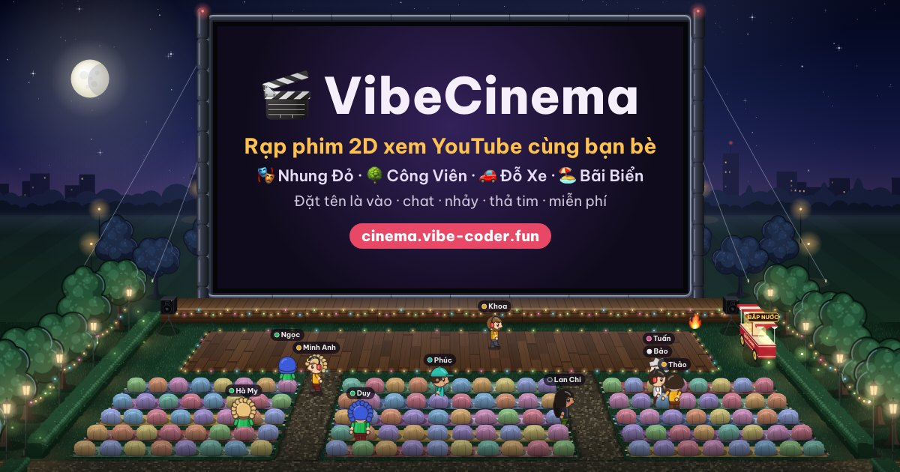

# 🎬 VibeCinema — rạp chiếu phim 2D xem YouTube cùng nhau

**Xem trực tiếp: https://cinema.vibe-coder.fun** · Mã nguồn: https://github.com/Hao2505/cinema

Phía trên là màn hình lớn — trình phát YouTube chính thức đặt khít vào khung màn hình. Phía dưới là khán phòng vẽ phối cảnh
3D: **mỗi người xem điều khiển một nhân vật**, đi lại, ngồi ghế, nhảy, vỗ tay, thả tim, chat bong bóng trên đầu. Ai cũng dán
được link YouTube vào hàng chờ; **cả rạp xem cùng một chỗ trong video — không ai tua / dừng riêng được**. Vào rạp chỉ cần
đặt tên + chọn nhân vật (nam / nữ, da, tóc, áo, quần, phụ kiện, râu), không cần đăng nhập.

- **4 rạp**, mỗi rạp một khung cảnh + màn hình + hàng chờ riêng: 🎭 **Rạp Nhung Đỏ** (trong nhà, ghế nhung), 🌳 **Rạp Công
  Viên** (ngoài trời, gối lười trên cỏ), 🚗 **Rạp Đỗ Xe** (kiểu Mỹ, ngồi xe mui trần), 🏖️ **Rạp Bãi Biển** (ghế xếp trên cát).
- **Kênh mặc định**: rạp trống video quá 30 giây thì tự phát một kênh trực tiếp 24/7; ai dán link là nhường ngay.
- Rạp phủ cả màn hình, nút bấm là các cụm nổi nhỏ không bao giờ che video; **đang chiếu thì xung quanh tối lại** cho video
  nổi bật, đứng yên vài giây các nút tự mờ đi.
- **⚙️ Tùy chọn** cho từng người xem: mức tối, ẩn chat / bong bóng / emoji / động tác / tên / người khác, ẩn riêng từng
  người (bấm vào nhân vật), đèn hiệu ứng, chất lượng hình.



## Chơi thế nào

| Làm gì | Máy tính | Điện thoại |
|---|---|---|
| Đi lại | `W A S D` hoặc phím mũi tên · bấm sàn để đi tới | kéo cần điều khiển góc trái · chạm sàn |
| Ngồi ghế | đi tới sát ghế rồi dừng (tự ngồi) · bấm vào ghế | chạm vào ghế |
| Âm lượng / toàn màn hình | 🔊 + thanh trượt, ⛶ dưới màn hình (riêng video) · ⛶ góc trên phải (cả rạp) | như máy tính |
| Chọn rạp | bảng chọn rạp ở màn vào rạp · bấm ô tên rạp góc trên trái | như máy tính |
| Vào lại lần sau | máy nhớ tên + nhân vật: mở trang là thấy thẻ "Chào mừng quay lại", bấm một rạp là vào | như máy tính |
| Góc xem | 📺 góc trên phải: Cân (khán phòng rộng) · **Màn lớn** (mặc định) · Màn rộng (video to nhất) | — |
| Tùy chọn | ⚙️ góc trên phải (làm tối khi chiếu, ẩn chat / động tác / người khác…) · bấm vào một nhân vật để ẩn riêng người đó | như máy tính |
| Động tác | `E` mở vòng chọn · phím `1`–`8` · 🎭 trên dock | 🎭 trên dock |
| Chat | `Enter` · ô nhắn trên dock | ô nhắn trên dock |
| Thả cảm xúc | 😀 trên dock | như máy tính |
| Chiếu video | 📋 trên dock → dán link YouTube vào **Hàng chờ** | 📋 |
| Xem lại chat | 💬 trên dock (ngăn kéo bên phải); tin mới hiện góc dưới trái | 💬 |

8 động tác: 👋 Vẫy tay chào · 👏 Vỗ tay · 🕺 Nhảy hip hop · 🤘 Lắc đầu quẩy · 🎶 Nhún nhảy · 🍿 Ngồi xem · ❤️ Thả tim · 🤣 Cười lăn.

## Luật rạp (mặc định, đổi trong `.env`)

- Chỉ nhận video **công khai, cho phép nhúng, không giới hạn tuổi, xem được ở Việt Nam**, dài tối đa **15 phút**
  (server hỏi YouTube Data API trước khi cho vào hàng chờ). Chủ kênh tắt nhúng giữa chừng → rạp tự chuyển bài.
- Mỗi người chờ tối đa **2 video**. Bỏ qua khi **≥ 50 %** người trong phòng bỏ phiếu (ít nhất 2 phiếu); người thêm bài
  bỏ qua bài của mình ngay.
- **Xem chung**: thanh tua / dừng của YouTube bị ẩn; lỡ dừng là tự chạy lại đúng giờ chung. Chỉ admin dừng được cả phòng.
- **4 rạp × 60 người** — mỗi rạp 130 ghế (5 hàng) + sàn nhảy lớn, đầy phòng vẫn thoáng; rạp đầy thì tự mở thêm phòng của
  chính rạp đó (tối đa 3 phòng / rạp), mỗi phòng màn hình + hàng chờ riêng.
- **Kênh mặc định** (`DEFAULT_VIDEO`): phòng trống video + hàng chờ trống quá 30 giây thì tự phát kênh trực tiếp; có video
  mới là nhường ngay; không bỏ phiếu bỏ qua được (admin bỏ qua thì phòng đó nghỉ 10 phút).
- Chat: không link, từ bậy bị che `***`, gửi dồn dập bị tắt tiếng 2 phút.
- Nút **🚩 Báo cáo** dưới màn hình: admin được báo ngay; **3 người** báo cáo cùng video thì rạp tự gỡ + chặn video đó.

## Chạy trên máy

Cần Node ≥ 20.

```bash
npm install
cp .env.example .env      # rồi điền ADMIN_TOKEN, YT_API_KEY (xem dưới)
npm run dev               # http://localhost:3300
```

Chưa có YouTube API key mà muốn xem thử ngay: chạy bản QA dùng YouTube **giả** + người xem giả:

```bash
npx tsx scripts/qa-server.ts                                           # http://localhost:3399
npx tsx scripts/bots.ts --url ws://localhost:3399/ws --n 10 --video aqz-KE-bpKQ   # 10 người xem giả
```

(Bản QA nhận mọi link và tính dài 3:20 — chỉ để thử giao diện. Mã admin của bản QA: `#admin=qa-local-admin`.)

## Tạo YouTube API key (5 phút, miễn phí — không bắt buộc nhưng nên có)

Chưa có key rạp vẫn chạy: dán link vẫn thêm được video, server kiểm cơ bản (có video + chủ kênh cho nhúng). Có key thì
kiểm đủ ngay lúc dán link (công khai, không 18+, xem được ở VN, giới hạn độ dài) và hàng chờ hiện thời lượng; không có
thì video 18+ / chặn VN chỉ bị bỏ qua lúc tới lượt, video dài bị cắt ở giới hạn phút. Chi tiết: docs/04 §3.1.


1. Vào https://console.cloud.google.com/ → đăng nhập Gmail → **Select a project → New project** → đặt tên `vibe-cinema` → **Create**.
2. Menu ☰ → **APIs & Services → Library** → tìm **YouTube Data API v3** → **Enable**.
3. **APIs & Services → Credentials → + Create credentials → API key** → copy key.
4. Bấm vào key vừa tạo → **API restrictions → Restrict key → chọn YouTube Data API v3 → Save**.
   (Muốn chặt hơn: **Application restrictions → IP addresses** → điền IP của VPS. Khi đó key chỉ chạy trên VPS; máy nhà
   cần một key thứ hai không giới hạn IP.)
5. Dán key vào `.env` (máy nhà) và `deploy/.env.production` (VPS): `YT_API_KEY=...`. **Không gửi key qua chat, không commit.**

Quota miễn phí 10.000 lượt / ngày; mỗi link mới tốn 1 lượt (kết quả được nhớ 6 giờ) — dư sức cho rạp.

## Admin

- Mở trang **một lần** kèm mã: `https://cinema.vibe-coder.fun/#admin=<ADMIN_TOKEN>` → trình duyệt nhớ (cookie HttpOnly, 1 năm),
  mã bị gỡ khỏi thanh địa chỉ. Mã nằm trong `deploy/.env.production` (production) / `.env` (máy nhà).
- Có nút 🛠: bỏ qua / tạm dừng / chiếu tiếp (cả phòng), **gỡ hẳn video** (khiếu nại bản quyền), đưa bài lên đầu, xoá bài,
  khoá hàng chờ, xoá chat, xem báo cáo, bỏ cấm, bỏ chặn video. Bấm vào một nhân vật: tắt tiếng 10 phút / 1 giờ, mời ra (2 phút không vào lại), cấm 1 ngày / vĩnh viễn.
- Video admin thêm: người thường **không bỏ phiếu bỏ qua được** (nút ⏭ ẩn), báo cáo cũng không tự gỡ — admin tự quyết.
- Người thường không thấy gì về hệ thống (file admin không được tải nếu không phải admin).

## Deploy (VPS dùng chung với VibeCorp)

```bash
npm test                              # xanh hết mới deploy
bash deploy/deploy.sh --setup         # lần đầu: kiểm cổng 3300, tạo /opt/vibecinema, nginx site riêng
bash deploy/deploy.sh                 # các lần sau
bash deploy/logs.sh                   # xem log
```

App chạy bằng pm2 tên `vibecinema`, cổng `3300`, thư mục `/opt/vibecinema`, site nginx `cinema.vibe-coder.fun`,
vùng giới hạn nhịp riêng `vcin_api` (`/etc/nginx/conf.d/vibecinema-limit.conf`) — không đụng `vibecorp` (3200) hay
`tokivietnam.com` (3000). Chi tiết + DNS Cloudflare: [docs/05-van-hanh-deploy.md](docs/05-van-hanh-deploy.md).

## Kiểm thử

```bash
npm test          # typecheck + test đơn vị + smoke toàn hệ thống (không ra Internet, ~15 giây)
npm run qa -- --out /tmp/vc-shots     # Chrome headless: chụp máy tính + điện thoại, bắt lỗi console, đo độ mượt
```

## Tài liệu

[docs/README.md](docs/README.md) — tổng quan, giao thức, frontend & độ mượt, YouTube & pháp lý, vận hành & deploy, kiểm thử.
Lịch sử thay đổi: [CHANGELOG.md](CHANGELOG.md). Chính sách hiển thị cho người xem: [/chinh-sach](public/chinh-sach.html).

Video do YouTube phát và thuộc về chủ sở hữu; rạp không tải, không lưu, không phát lại video.
